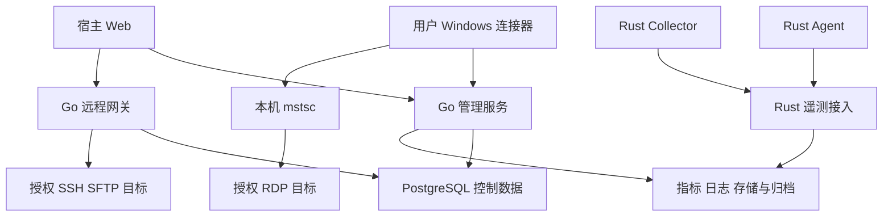

# InfraScope 架构与接口契约

此文档规定实现边界和必须补齐的契约。已有接口优先适配并维持兼容；新增路由为建议基线，应在 P1 固化为 OpenAPI/JSON Schema 与版本化消息规范。不能把下列职责表直接当成已实现的 API。

## 1 组件职责

| 组件 | 运行位置 | 负责 | 不负责 |
|---|---|---|---|
| 宿主 Web 前端 | 用户浏览器 | 原有页面、主题、查询、操作、LinuxTab、文件流与反馈 | 直接原始 TCP SSH、持久保存远程密码、替代服务端授权 |
| Go 管理服务/BFF | 中央平台 | 身份、组织、资产、策略、告警/通知编排、审计和统一 API | 在中央服务器启动用户 mstsc |
| 现有 Go 远程网关 | 可达目标的受控节点 | SSH/SFTP、会话/文件任务、主机信任、RDP 任务授权 | 另建一套用户系统或任意内网代理 |
| Rust 遥测服务 | 中央/边缘服务节点 | 身份受控接入、持久接收、校验/解析/聚合、质量和数据面查询 | 信任浏览器指定租户或无界存储进程内状态 |
| Rust 主机 Agent | Windows 服务/Linux systemd | OS、网络、登录、日志、Docker 采集、本地持久队列与配置 | GUI mstsc；默认无任意远程 shell |
| Rust Collector | 授权站点/网络 | SNMP、只读 API、Syslog/Trap、外部服务/DNS/TLS 探测 | 自动扫描任意公网或配置设备管理员账号 |
| Windows 本机连接器 | 操作者交互式 Windows 登录会话 | 配对、设备认证、受控凭据、PowerShell、rdpsign、mstsc、残留回收 | Session 0 直接弹用户 GUI、网页 RDP、强保证远端强制下线 |
| PostgreSQL | 可信数据区 | 身份/资产/授权/配置/任务/事件/审计、事务、分区遥测起步方案 | 无需容量评估就承诺海量全文和无限时序 |
| 日志/指标物理存储与归档 | 数据区 | 热数据查询、生命周期、冷归档与可恢复索引 | 单凭上传成功就宣称归档可恢复 |

浏览器与平台同源 HTTPS/WSS；采集使用 mTLS 或等效设备认证；网关间使用受信 TLS 与明确 egress。RDP 数据面从用户电脑到目标，SSH/SFTP 从所属网关到目标。这两类可达性必须分别测试。

## 2 项目内落点及迁移顺序

当前路径是调查起点，不要求重命名仓库：

| 路径/职责 | 实施动作 |
|---|---|
| dist/index.html、app.js、现有 *core.js 与页面 | 保留原组件；通过统一 API adapter 替换 production 下的演示数据；原型 fixture 单独标记 |
| dist/remote-access.js、remote-workspace.html | 复用并补真实多窗口、输入、文件、权限的浏览器回归 |
| remote-access/internal/access、migrations | 复用身份、账号、授权、SSH/SFTP/RDP 代码，按 ADR 扩展统一控制平面 |
| 新增 Rust workspace 的 agents/collectors/telemetry | 在原仓库创建职责清楚的子目录，共用 CI、配置版本、身份契约和资产 ID |
| windows-connector | 保留本机兼容行为与受控模式，补 Windows 实机测试和兼容报告 |
| docs 与 tests | 增量保留；加入需求矩阵、协议契约、跨端测试、部署/回退文档 |

严禁把浏览器本地演示资产直接批量变成可信远程目标。迁移须预览、确认来源和目标范围、去重后创建，秘密单独注入。远程 ra_assets 与新增全局 Asset 建立唯一可信映射或有审计的合并迁移，不能出现两个同名 ID 世界无法互查。

旧登录已存在时复用其用户；本项目现有 ra_users 已是实际应用身份来源，后续扩展应在此基础上演进或明确迁移，不能再建一个“监控登录”。

## 3 控制面与数据面契约

### 3.1 数据共用信封

所有请求/事件必须有版本与稳定关联，客户端不能任意指定可信范围。示意字段：

~~~json
{
  "schemaVersion": "1",
  "eventId": "stable-source-event-id",
  "assetId": "server-issued-id",
  "sourceId": "server-approved-source",
  "agentId": "authenticated-device-id",
  "sourceGeneration": "boot-or-source-generation",
  "sequence": "128437",
  "observedAt": "2026-10-18T02:14:39.123Z",
  "sourceTime": null,
  "quality": {
    "state": "valid",
    "clock": "unknown",
    "coverage": 1.0,
    "reason": null
  },
  "configVersion": "17",
  "payload": {}
}
~~~

workspace/site 从认证和注册绑定解析；若请求带 scope 字段必须与服务端绑定相符。eventId 代表一次事实，不用正文 hash 替代。64 位计数器、序列、纳秒和大文件字节数在 JSON 用十进制字符串或明确安全整数边界，浏览器计算使用 BigInt/受控转换，避免超过 2^53 精度丢失。

每种 payload 有独立 schema、字段类型/长度/单位/枚举、最大条数和字节数；客户端版本兼容范围明确。日志正文不与网络指标共用无限 JSON 对象。API 网关、服务和客户端重复验证关键边界。

### 3.2 可靠接收与确认

1. 源记录和游标进入可共同恢复的本地队列/WAL；不能先推进游标再丢失未落盘数据。
2. Agent 按 sourceGeneration + sequence 批量传输；批次是传输封装，不是事件唯一身份。
3. 服务端鉴权、校验、幂等后达到约定的持久边界才 ACK；ACK 最高连续序号和缺失段单独表示，不确认中间尚未持久的洞。
4. 选择“直接持久目标存储”或“持久接入日志后异步索引”之一并写 ADR。异步时 ACK 不等于可查询，必须返回/暴露 indexed watermark。
5. 跨 PG/日志库/消息队列使用 Outbox、幂等消费者和可重放记录，不能两次非原子写入后声称事务完成。
6. 毒性记录可以隔离，但隔离确认、原始受保护备份、原因、重放版本与丢弃计数必须明确。
7. 重试有退避/抖动/上限和永久错误分类；服务重启、ACK 丢失、重复批次不重复生成告警和通知。

### 3.3 时间与缺口

UTC 存储；UI 默认 Asia/Shanghai，可用户覆盖并显示时区。事件时间、观察时间、接收时间、可查询时间、前端展示时间分别保存/计量。时间排序需稳定事件 ID 作 tie-breaker。

本机采样间隔使用单调时钟；墙钟用于展示和跨系统关联。NTP 跳变、休眠、时钟漂移、源时间缺失分别标记。源→观察时间差含时钟偏差，不必然是传输延迟。跨源合并采用迟到容忍和 watermark；修正产生新评估版本，保留原结论。

缺口记录至少包含源/代次、时间范围、序号范围、原因、已知丢失条数或 unknown、检测时间、恢复状态。收到新数据只结束当前断采，不填平历史缺口。

## 4 准确性设计

### 4.1 网络速率

同一资产、同一接口身份/代次、同一采样口径的两点：

~~~text
delta_rx_bytes = rx_counter_2 - rx_counter_1
interval_seconds = (monotonic_ns_2 - monotonic_ns_1) / 1e9
rx_bytes_per_second = delta_rx_bytes / interval_seconds
rx_bits_per_second = rx_bytes_per_second * 8
tx 同理
~~~

保存原始 counter、interval、代次及质量，服务端可重算。UI 说明 Mbps=10^6 bit/s，MiB/s=2^20 byte/s。不要固定除以“配置的 1 秒”，不要只保存四舍五入后的显示值。

以下情况建立新基线或标无效：首点、非正间隔、系统/接口代次改变、计数器回退、计数器不连续标识变化、异常过长间隔。SNMP 结合 sysUpTime 和 ifCounterDiscontinuityTime；优先 ifHCInOctets/ifHCOutOctets。32 位 wrap 只有在周期、链路上限和单次溢出可证明时修正，否则未知。

经过较长缺口后若代次与计数器连续，可报告“该长区间累计增量/平均率”，但不能把它摊成未采到的每秒曲线。无法证明连续则累计量也标未知/不完整。

聚合平均率=有效增量总和/对应有效时长。峰值须指明“1 秒采样区间峰值”或汇总桶峰值；1 分钟均值无法重建秒级峰值。历史分桶保存 sum_bytes、covered_duration、count、min/max/mean、gap_count。边界不足时标估算或仅统计完整区间，不暗中线性插值。

Linux 从原生 netlink/内核统计读取，Windows 使用适用的 IP Helper/性能 API 并核对计数器定义，交换机使用支持的 IF-MIB/厂商字段。不同层计数器可能包含不同头部、卸载、隧道或转发口径，不能声称与应用负载逐字节相等。参考依据 [S1][S3]；算法和产品门槛为本项目设计。

精度验收分两层：

- 计算正确：固定原始计数器与时间输入，期望差值/单位换算完全可复算，仅显示舍入容差。
- 实机可比：同一接口、同一计数器 API、同一时间窗，与独立参考采集对照；边界时间差造成的容差要由线速×时间差等方式给出，不任填 1%。
- iperf/文件传输用于产生可控负载，不能单独作为二层/三层计数器绝对相等证据。

### 4.2 CPU 内存磁盘和容器

CPU counter 差值分母与分类必须固定；首次采样与重启后未知。总量百分比与多核“使用核数”区分。Windows/Linux 所得分类不能不经映射混在一列。

内存报告原始 used/available/cache 等事实及派生公式；容器展示 raw usage 和可选 working set/CLI 对齐值，注明 cgroup 版本。Docker API 与 CLI 对缓存的处理不同 [S4]。磁盘容量的 GB/GiB、reserved/free/available、文件系统/设备、读写字节/IOPS 不能混算。

### 4.3 状态和连续运行

系统 uptime 来自启动事实/单调时间；连续探测成功从最近完整连续有效检查起算；平台观测时长从首个接入起算。这三者分别显示。

网络失联、Agent 不健康、服务高延迟、已确认关机和维护为独立事实；离线判定保留“从哪个位置、哪个协议、最后成功、失败次数”。未知不能被当作成功算入 SLO。

## 5 日志数据模型与查询

| 字段组 | 必需内容 |
|---|---|
| 身份 | workspace、site、asset、source、agent、generation、sequence/eventId |
| 时间 | eventTime 可空、observedTime、ingestedTime、原始时区/文本/精度/质量 |
| 内容 | 脱敏 body、原级别、规范 severity、attributes、parserVersion、multiline/truncated/parseStatus |
| 关联 | serviceId、dockerGroupId、containerInstanceId、requestId、可选 traceId/spanId |
| 审计信息 | actor、sourceIP、loginType、outcome、OS 原始 event/record 标识，按权限显示 |
| 治理 | sensitivity、retentionPolicy、redactionVersion、scope、归档定位与完整性摘要 |

对齐 OpenTelemetry 的 Timestamp/ObservedTimestamp 区分，字段可以适配内部命名 [S2]。未采集 tracing 不生成假 span 拓扑。

上下文查询只在同源/同实例/同代次或明确 trace 关系内扩展；必须同样应用数据权限。全文查询编译成受控 AST，不把用户 query 直接拼 SQL。分页游标绑定排序、时间窗口、过滤版本和 scope。Tail 有背压、断线游标及明确丢失提示。

安全审计、业务日志、平台操作审计分别设置保留和访问。源端尽早脱敏，原文如需保留必须受保护；脱敏失败时隔离，不继续向通知/AI 输出。

## 6 数据库与存储概念模型

表名遵守现有迁移规范。每个共享对象有 workspace/稳定 ID/版本；所有关联按同一 scope 约束，软删除不遗留可用授权。

| 领域 | 概念模型 | 关键约束和索引 |
|---|---|---|
| 身份人员 | User、Role、Group、Membership、Person、DirectoryBinding、LoginSession | 唯一登录标识；企业 corp+member ID；人和登录身份显式映射；失效版本 |
| 资产拓扑 | Asset、Endpoint、Interface、Disk、Relation、OwnershipHistory、DiscoveryFact | 稳定 ID；接口代次；来源/时间；关系区间；IP 可重复但端点作用域明确 |
| 容器服务 | DockerGroup、ContainerInstance、Service、Deployment、PortBinding、Domain、ProbeTarget | 环境/项目/逻辑名组唯一；实例不覆盖；服务入口多对多 |
| 采集 | Agent、Collector、Enrollment、Certificate、Capability、ConfigRevision、Source、Cursor、Gap | 注册一次消费；配置 desired/applied；源身份变更建新代次 |
| 指标 | MetricDefinition、Sample、CounterInterval、Rollup、RetentionPolicy | metric+实体+代次+时间/序号幂等；单位、质量；时间分区与可控标签 |
| 日志 | LogRecord、ParserRevision、RedactionPolicy、DeadLetter、ArchiveManifest | source+generation+sequence 幂等；时间与结构化索引；归档摘要/保留 |
| 探测 | ProbeResult、ProbeConfigRevision、LocationHealth | 目标+执行 ID 幂等；阶段耗时/结果/位置；配置版本 |
| 事件通知 | Rule、RuleRevision、Evaluation、Incident、Evidence、Silence、Maintenance、Outbox、DeliveryAttempt、Ack | 去重键、事务 outbox、状态迁移、供应方返回 ID、重试与结果 |
| SRE AI | SLO、SLIWindow、BudgetSnapshot、Change、Runbook、Investigation、ModelRun、ToolExecution | 分母/覆盖/算法版本；证据快照；工具授权、执行与回退 |
| 远程 | 已有 RemoteAsset/Endpoint、Account、Secret、Grant、HostKey、Session、AttachLease、Transfer/Item/Chunk | 密钥/策略/凭据版本；owner；offset/hash；同范围 FK；原子票据消费 |
| 连接器 | Connector、BrowserBinding、PairingChallenge、Nonce、RdpLaunch | user+设备+Windows 用户绑定；一次消费、过期、幂等、清理状态 |
| 审计 | AuditEvent、ExportJob、RetentionHold | 追加；actor/scope/object/result/correlation；秘密不入库 |

PG 运行角色和迁移角色分开；审计仅追加并防普通用户修改；超级用户能力必须如实说明。归档删除先检查保全、备份和恢复策略，使用可重入任务。

建议起步用 PG 分区承载受控规模的指标/日志；是否引入专用时序或日志检索存储，P1 使用代表性数据做 ADR：

- 保持 PG 为控制面事实来源，避免两套授权数据库。
- 比较写入吞吐、全文/字段聚合、磁盘、保留操作、查询延迟、备份恢复和维护成本。
- 若目标容量超出当前方案，必须在对应阶段完成替代存储和端到端验证，不把核心日志功能无限后延。
- 新中间件必须有明确职责、部署、监控、故障模式和人员成本，不为“新型架构”堆组件。

## 7 容量计算与限额

需求收集表至少包括：主机/设备数、平均/最大接口数、每实体指标数、采样周期、日志平均与峰值 EPS、平均/p99 事件大小、保留期、压缩/索引倍率、同时查询人数、SSH 数、文件任务数、出口带宽、故障恢复追赶时长。

~~~text
metric_points_day = Σ(series_count_i × 86400 / interval_i)
log_raw_bytes_day = average_EPS × average_bytes × 86400
required_log_disk ≈ daily_bytes × retention_days × measured_storage_factor
required_total_disk = data + index + WAL + replica + archive_staging + headroom
agent_queue_bytes ≈ peak_bytes_per_second × tolerated_outage_seconds × measured_queue_factor
~~~

例：1000 台 × 8 接口 × 2 字节计数器 ÷ 1 秒 = 16000 点/秒，约 13.824 亿点/天，仅是这两个网络指标的逻辑点数；是否合并成宽行不会消除等价数据量。不能“采样 1 秒、保存一年、所有数据 PG”却不做容量预算。压缩倍率必须实测，不固定假设。

限额至少包括用户/账号/网关 SSH 数、SFTP 通道/任务/带宽/临时磁盘、Agent 源数/WAL/单条/吞吐、查询并发/超时/时间跨度/导出、通知/AI 预算。拒绝用 413/429 或明确错误，不导致其他用户连带崩溃。

## 8 API 家族与职责

前缀沿用宿主；建议新增管理族 /api/v1，远程保留 /api/remote-access。不能未经迁移覆盖已有路由。

| API 家族 | 最少操作 | 持久数据/权限和关键响应 |
|---|---|---|
| /auth、/users、/groups、/directory | 登录退出、改密、重置、成员同步、人员搜索 | 统一主体；二次认证；同步游标与状态，不回显 token |
| /assets、/asset-groups、/relations | CRUD/归档、发现预览/确认、批量导入、owner、能力和拓扑 | 受 scope 的服务端搜索/分页；版本冲突 409 |
| /agents、/collectors、/policies | 一次注册、证书轮换、心跳、能力、配置期望/应用、灰度 | 注册凭证短期一次；设备不能代写其他资产 |
| /telemetry/metric-batches、/telemetry/log-batches | 批量持久接收、部分拒绝、ACK、水位 | mTLS/设备身份；schema、压缩后/解压后限额；幂等 |
| /metrics/query、/network/interfaces、/network/history、/network/top | 原始/汇总/排行、质量、区间、游标、导出 | 返回单位、实际采样间隔、覆盖率、缺口和 resolution |
| /docker-groups、/container-instances | 组/实例/历史、端口、健康、负责人/规则 | 组权限下钻，实例替换不丢组历史 |
| /devices/switches、/nas、/pve、/printers、/scanners | 配置、能力、快照、端口/资源/错误、采集测试 | 只读凭据引用；不支持原因；协议专属超时 |
| /services、/domains、/probes | CRUD、绑定、计划/一次探测、历史、阶段延迟 | 受控目标/位置；探测 task ID；实际执行结果 |
| /logs/search、/logs/context、/logs/tail、/logs/export | 查询、上下文、受控实时流、异步导出 | query AST、游标、脱敏、scope、时间与资源上限 |
| /log-sources、/parsers、/redactions、/archives | 源配置、版本、样本试解析、隔离重放、归档/恢复 | 试解析不执行输入；变源保留旧记录；恢复任务可查 |
| /rules、/incidents、/silences、/maintenance | 规则版本/试算、事件、确认、指派、恢复/关闭 | 事件证据不可随规则编辑静默改写 |
| /notification-channels、/routes、/deliveries | 配置、测试、队列/重试、投递/回执/确认 | 真实测试动作授权；provider accepted 与已读分开 |
| /slos、/budgets、/changes、/capacity | SLI/SLO、历史预算、变更、预测 | 分母/覆盖/版本/区间；未知不参与健康计算 |
| /investigations、/ai/providers、/diagnostic-tasks | 授权检索、模型、证据/候选、工具计划/执行/取消 | 只读默认，注入隔离，调用与工具预算 |
| /audit-events、/exports、/platform/health | 受权检索/导出、平台健康、版本与容量 | 元数据分页、无秘密、管理员全局范围仍受 scope |

### 8.1 每个 API 必须补全的模板

~~~text
Operation ID / REQ IDs / 实际方法路径
请求 schema / 必填、长度、枚举、单位、互斥字段、默认值
认证方式 / 操作权限 / scope 与对象所有权 / 二次认证
响应 schema / 状态与数据质量 / 是否可空 / 分页和排序
幂等键作用域、TTL、重试行为 / 并发版本控制
超时、大小、速率、资源预算 / 流中断与取消
错误码、HTTP 状态、可重试性 / 关联 requestId
审计字段与脱敏 / 契约和权限负例测试
~~~

统一错误建议：

~~~json
{
  "code": "permission_denied",
  "message": "当前账号没有该文件操作权限",
  "requestId": "opaque-id",
  "retryable": false,
  "details": {"operation": "sftp.upload"}
}
~~~

401 未认证、403 禁止、404 不存在或防枚举、409 冲突/状态不符、410 失效、413 超限、429 限流、502/503/504 网关问题。不要把密码、SQL、密钥路径或内部异常对象放 details。

### 8.2 关键实例契约

指标查询返回的数据形状至少包含 seriesId/entityId/interfaceGeneration/metric/unit/temporality/resolution/timeRange/quality/coverage/gaps/points。排行查询返回 rankMetric、asOf、freshnessThreshold、excludedCount，避免旧值霸榜。

服务探测结果包括 startedAt、completedAt、observerId、configVersion、dns/tcp/tls/ttfb/total 时间、statusCode/expectedMatched、errorClass；未执行的阶段为 null，不用零表示成功。

通知 outbox 记录 eventId、ruleVersion、routeVersion、recipientStableIds、dedupeKey、payloadRef、attempt、providerMessageId、acceptedAt、deliveredAt 可空、userAckAt 可空，回执必须验证提供方签名/来源。

### 8.3 现有远程协议

以仓库 docs/remote-access/API.md 为当前接口事实，附件第 32 节为职责全集。至少保持：

- 资产/账号/凭据/授权、我的访问、host key 测试与批准。
- SSH session 创建/查询/关闭、attach 授权、WSS attach/input/resize/heartbeat/close 与 output/status/error。input seq 不跨租约重用，禁止重连重放命令。
- SFTP entries/mkdir/rename/delete 与独立 TransferTask。上传 manifest 分页提交，二进制块 offset + SHA256，commit、pause/retry/cancel、单项取消、内容下载。
- 配对挑战、连接器/浏览器绑定、设备签名请求和 nonce、防重放的 RDP 任务、兑换与反馈。

现有保护性默认：4 MiB 上传块、1 MiB JSON、64 KiB WS、60 秒 SSH 重附着宽限、60 秒 RDP 票据、10 秒网关续租/30 秒租约等须重新从代码确认。限制是资源保护，不是吞吐保证；改动需同步前端、代理和客户端。

已有“测试通过”的接口仍需按真实 Windows、浏览器和原生 PG 验收，不能只复制历史报告。

## 9 关键业务事务与状态机

| 链路 | 原子边界/幂等点 | 非原子外部结果的处理 |
|---|---|---|
| 采集接收 | 稳定事件写入 + 接收记录 | 索引后水位独立，不先 ACK 未持久数据 |
| 告警到通知 | 评估/事件状态 + Outbox 同事务 | 外部供应方可能重复；使用幂等和重复检测，不承诺严格一次送达 |
| 授权变更 | Grant/version + 撤销事件 | 推送失败用周期复核/租约兜底，记录传播耗时 |
| 上传 | Chunk hash/offset 确认和任务进度 | 远端写成功 DB 失败时校验后重试，不能直接追加 |
| 文件提交 | 临时文件校验 + 安全 rename 后记录 | 无分布式原子事务，记录可恢复状态和 reconcile，不删错已有文件 |
| RDP 兑换 | 带绑定/版本的短期任务单次消费 | mstsc 启动失败不能重放已消费票据，应新授权任务 |
| 本机清理 | 自己拥有的文件/凭据版本与日志 | 外部进程竞争无法原子比较删除，严格策略失败关闭并提示 |
| 归档 | Manifest/摘要/持久写入与可读确认 | 源删除必须等待校验、策略与保全检查；恢复检索单独验证 |

事件状态和维度不得混淆：silenced 不等于 resolved；provider accepted 不等于 delivered；mstsc started 不等于 authenticated；bytes transferred 不等于 committed；agent online 不等于 service healthy。

## 10 部署与运维最低契约

- 中央服务与网关可以同机起步，但职责、资源限制和密钥访问范围分开；跨站点无需另建账号系统。
- 同域反向代理提供 HTTPS/WSS，关闭会破坏文件流式行为的缓冲，配置请求/idle/upgrade 大小和超时；生产不关闭 TLS 校验。
- 监控 Agent 以最小所需权限运行，敏感 Windows 通道和 Docker 能力单独授权；RDP 连接器在当前交互用户会话。
- 数据库迁移有前置备份、版本检查、幂等/兼容验证、运行角色权限。回退优先功能开关和兼容版本，不 DROP 真实审计/授权表。
- 密钥与数据库分开备份，恢复同时需要兼容 key version。设备撤销、CA 轮换、主密钥轮换、错误配置回退都有操作步骤。
- 供应方不可用、日志存储满、PG 不可用、Collector 离线、网关重启和网络分区均有观测与错误状态；不能用无限重试隐藏故障。
- 发布产物包括前端、Go/Rust 二进制、Windows 连接器、迁移、配置样例、SBOM、版本矩阵、回退包及环境验收结果。

## 11 已核对的一手技术依据

下列用于核对数据语义，具体依赖版本和设备兼容性在实施当天继续核查。不能将本文参数当成这些标准的硬性要求。

| 编号 | 来源 | 本文使用范围 |
|---|---|---|
| S1 | https://www.rfc-editor.org/rfc/rfc2863 | 64 位接口计数器、重启与计数器不连续处理 |
| S2 | https://opentelemetry.io/docs/specs/otel/logs/data-model/ | 事件时间与观察时间、日志关联字段 |
| S3 | https://learn.microsoft.com/en-us/windows/win32/api/netioapi/nf-netioapi-getiftable2 | Windows 接口枚举能力；具体字段口径需核对对应结构文档 |
| S4 | https://docs.docker.com/reference/cli/docker/container/stats/ | Docker API/CLI 内存缓存统计差异 |

核对日期 2026年10月18日。其余产品架构、指标目标与阶段划分是针对本项目提出的设计要求。
